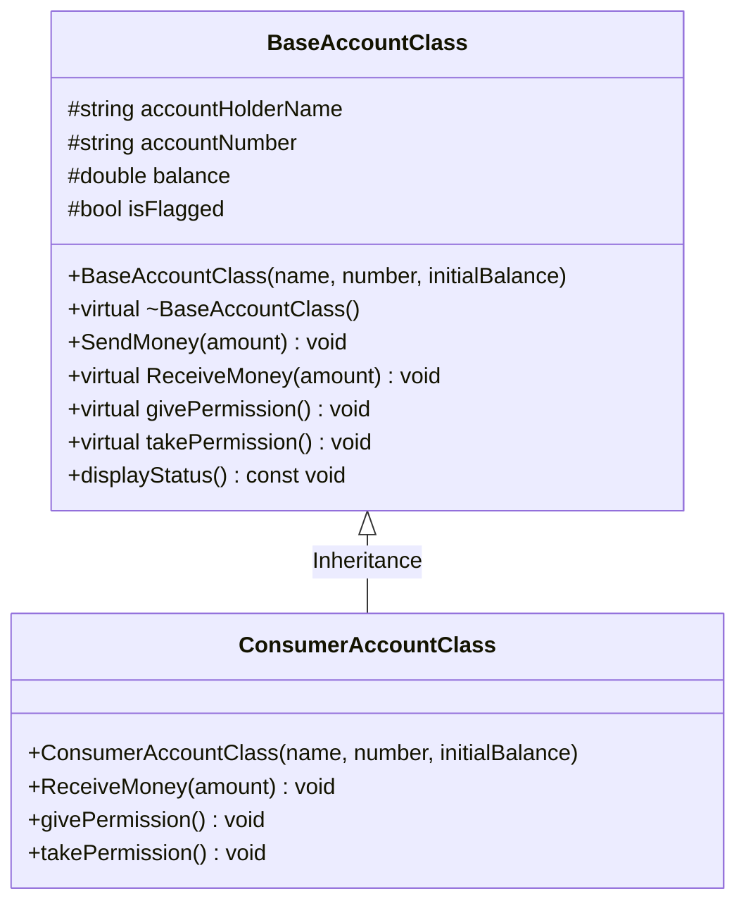

# Bank Account Flagged / Security Simulation

A C++ Object-Oriented Programming (OOP) demonstration developed for **CSE 202**, simulating security flag restrictions and permission management on a bank account using **Runtime Polymorphism**, **Inheritance**, and **Virtual Functions**.

---

## 📌 Problem Overview

The objective of this project is to simulate a security workflow where a user's bank account can be flagged due to suspicious activities (such as an unauthorized hack attempt). 

When the account is flagged:
- All transaction permissions are revoked.
- Both outbound transfers (`SendMoney`) and incoming deposits (`ReceiveMoney`) are blocked.

When the account is verified and unflagged:
- Permissions are restored.
- Transactions resume normally.

---

## 🏛️ OOP Architecture

The design consists of two core classes demonstrating runtime polymorphism via base-class pointers:



### 1. `BaseAccountClass`
* **Attributes**:
  * `accountHolderName` (`std::string`): Name of the account holder.
  * `accountNumber` (`std::string`): Unique account identifier.
  * `balance` (`double`): Current account balance.
  * `isFlagged` (`bool`): Security state tracking whether permissions are revoked (`true`) or granted (`false`).
* **Key Methods**:
  * `SendMoney(double amount)`: **Non-virtual function** (early/compile-time binding). Deducts amount from balance if balance is sufficient and account is not flagged.
  * `virtual ReceiveMoney(double amount)`: **Virtual function** (late/runtime binding). Credits funds to the balance if the account is not flagged.
  * `virtual givePermission()`: Unflags the account and enables normal transactions.
  * `virtual takePermission()`: Flags the account and suspends transaction capabilities.
  * `displayStatus()`: Prints the current account balance and flag state.

### 2. `ConsumerAccountClass`
* Inherits publicly from `BaseAccountClass`.
* **Method Overrides**:
  * `ReceiveMoney(double amount) override`: Polymorphically intercepts incoming transactions, validates the account security status, logs an alert if flagged, or forwards to base logic if active.
  * `givePermission() override`: Specialized consumer security log and flag removal.
  * `takePermission() override`: Specialized consumer fraud alert trigger and account lockdown.

---

## 🔄 Runtime Polymorphism in Action

Runtime polymorphism occurs when derived class behavior is executed dynamically at runtime through a base class pointer or reference:

```cpp
// Instantiating derived class object
ConsumerAccountClass consumerAcc("Alice Johnson", "ACC-987654321", 5000.0);

// Upcasting: Base pointer points to derived object
BaseAccountClass* accountPtr = &consumerAcc;

// Dynamic Binding (late binding via vtable):
accountPtr->takePermission();    // Calls ConsumerAccountClass::takePermission()
accountPtr->ReceiveMoney(1000);  // Calls ConsumerAccountClass::ReceiveMoney()
accountPtr->givePermission();    // Calls ConsumerAccountClass::givePermission()

// Static Binding (early binding resolved at compile-time):
accountPtr->SendMoney(500);      // Calls BaseAccountClass::SendMoney()
```

---

## 🚀 How to Compile and Run

### Prerequisites
* A C++ compiler supporting C++11 or higher (e.g., GCC/MinGW `g++`, Clang, or MSVC).

### Using MinGW / GCC (`g++`):
```bash
# 1. Compile the program
g++ -std=c++17 -Wall "Bank_Account_Hacked.cpp" -o Bank_Account_Hacked.exe

# 2. Run the executable
.\Bank_Account_Hacked.exe
```

---

## 📋 Sample Simulation Output

```text
==========================================
  BANK ACCOUNT FLAGGED / HACK SIMULATION  
==========================================

[INITIAL STATE]
------------------------------------------
Account Holder : Alice Johnson
Account Number : ACC-987654321
Current Balance: $5000
Account Status : ACTIVE (Permissions Granted)
------------------------------------------

[1. NORMAL TRANSACTIONS]
Amount sent: $1200 | Remaining Balance: $3800

[Consumer Account Log] Processing ReceiveMoney via Runtime Polymorphism...
[Consumer Account Security Check] Status clear. Depositing funds...
Amount received: $800 | New Balance: $4600
------------------------------------------
Account Holder : Alice Johnson
Account Number : ACC-987654321
Current Balance: $4600
Account Status : ACTIVE (Permissions Granted)
------------------------------------------

[2. SUSPICIOUS ACTIVITY DETECTED - TAKING PERMISSIONS]

>>> [SECURITY ALERT - Consumer Account]: SUSPICIOUS ACTIVITY! Permissions REVOKED. Account FLAGGED! <<<
------------------------------------------
Account Holder : Alice Johnson
Account Number : ACC-987654321
Current Balance: $4600
Account Status : FLAGGED (Permissions Suspended)
------------------------------------------

[3. ATTEMPTING TRANSACTIONS WHILE ACCOUNT IS FLAGGED]
--- Attempt to SendMoney ($500.00) ---
[ACCESS DENIED] Account ACC-987654321 is FLAGGED! Permission revoked for SendMoney.

--- Attempt to ReceiveMoney ($1000.00) ---

[Consumer Account Log] Processing ReceiveMoney via Runtime Polymorphism...
[ALERT] Consumer Account (ACC-987654321) is currently FLAGGED.
[SECURITY BLOCKED] Deposit of $1000 denied due to revoked permissions.
------------------------------------------
Account Holder : Alice Johnson
Account Number : ACC-987654321
Current Balance: $4600
Account Status : FLAGGED (Permissions Suspended)
------------------------------------------

[4. IDENTITY VERIFIED - GIVING PERMISSIONS BACK]

>>> [SECURITY OVERRIDE - Consumer Account]: Permissions RESTORED. Account UNFLAGGED. <<<
------------------------------------------
Account Holder : Alice Johnson
Account Number : ACC-987654321
Current Balance: $4600
Account Status : ACTIVE (Permissions Granted)
------------------------------------------

[5. TRANSACTIONS AFTER RESTORING PERMISSIONS]

[Consumer Account Log] Processing ReceiveMoney via Runtime Polymorphism...
[Consumer Account Security Check] Status clear. Depositing funds...
Amount received: $1500 | New Balance: $6100
Amount sent: $300 | Remaining Balance: $5800

[FINAL STATE]
------------------------------------------
Account Holder : Alice Johnson
Account Number : ACC-987654321
Current Balance: $5800
Account Status : ACTIVE (Permissions Granted)
------------------------------------------
```

---

## 📂 File Structure

| File | Description |
| :--- | :--- |
| [`Bank_Account_Hacked.cpp`](./Bank_Account_Hacked.cpp) | Core source file implementing classes, virtual methods, and the simulation runner. |
| [`README.md`](./README.md) | Documentation explaining the project structure, polymorphism concepts, and execution guide. |

